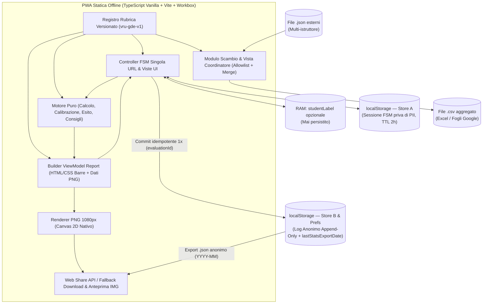
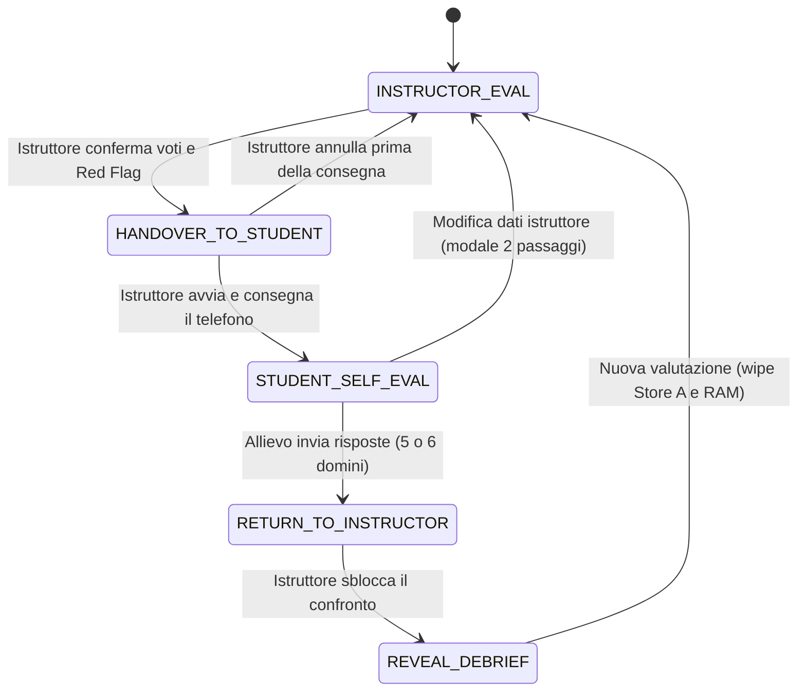

# Web App di Valutazione VRU (Autovalutazione Allievo + Valutazione Istruttore)

* **Author:** Leo
* **Status:** Proposed
* **Date:** 2026-11-24

--------------------------------------------------------------------------------

## Overview

Questa specifica definisce una web app mobile-first statica (PWA senza backend) progettata per funzionare offline sullo smartphone dell'istruttore di guida al termine di una lezione pratica su strada. L'applicazione digitalizza la scheda di valutazione per la tutela degli utenti vulnerabili della strada — **VRU** (*Vulnerable Road Users*: pedoni, ciclisti e conducenti di monopattini) — definita in [griglia_valutazione_vru_istruttori.pdf](../../griglia_valutazione_vru_istruttori.pdf) (protocollo CIECA / EFA / FORS, Matrice **GDE** — *Goals for Driver Education*, Livelli 1–4, criteri di esclusione PRACDRIVA e debriefing maieutico **GROW** — *Goal, Reality, Options, Will* — del progetto HERMES).

L'applicazione permette all'istruttore di registrare la propria valutazione sui 6 domini di guida (con opzione `N/A` per veicoli privi di **ADAS** — *Advanced Driver Assistance Systems*) e sulle 3 Red Flag, quindi consegnare lo smartphone all'allievo per un'autovalutazione cieca sugli stessi domini formulata in italiano non tecnico. Al termine, una schermata di riconsegna precede il debriefing sul confronto grafico tra le due valutazioni. L'istruttore può esportare e inviare all'allievo un'immagine PNG con punteggi, grafico, esito e consigli deterministici di ripasso, senza conservare archivi nominativi dell'autoscuola. In parallelo, l'app salva in locale record statistici anonimi a livello di autoscuola/gruppo, esportabili in formato `.json` versionato, aggregabili localmente da un coordinatore di più istruttori e riesportabili in `.csv`.

## The Problem

La gestione della scheda VRU sul veicolo presenta quattro ostacoli operativi:

1. **Limiti della carta e del PDF compilabile su smartphone:** La scheda cartacea non calcola scarti e soglie, non produce un promemoria grafico inviabile all'allievo in chat e richiede trascrizione manuale per ricavare statistiche. Un PDF compilabile (AcroForm) non risolve il problema su smartphone: i lettori PDF mobile disabilitano o eseguono in modo incoerente gli script necessari per nascondere voti e Red Flag durante l'autovalutazione cieca, non generano grafici dinamici né immagini leggibili in chat.
2. **Compromissione dell'autovalutazione cieca e del debriefing GROW:** Su un modulo non isolato l'allievo può vedere i voti o le Red Flag dell'istruttore prima di autovalutarsi, falsando l'indice di calibrazione (`Overconfidence = A - I`). Inoltre la scheda originale usa termini specialistici (*Dutch Reach*, *Right-Hook*, *Automation complacency*, *Traffic Safety Culture*, *Livello 4 GDE*) poco comprensibili per un allievo, e non separa l'invio dell'autovalutazione dalla rivelazione di un eventuale esito negativo.
3. **Incongruenze interne della scheda sorgente:** Il documento sorgente riporta un intervallo matematico impossibile (`1–30` invece di `6–30` per 6 domini da 1 a 5), un grafico a pagina 2 le cui 6 barre non coincidono con i 6 domini delle tabelle di pagina 1 (manca *Autocontrollo e Pressione Sociale*), nessuna gestione per veicoli privi di ADAS e nessuna soglia automatica che separi `MODULO INTEGRATIVO` da `NON IDONEO` (lasciando tale distinzione al giudizio didattico dell'istruttore).
4. **Consegna all'allievo e statistiche di gruppo senza rischi privacy o legali:** L'istruttore necessita di inviare un promemoria leggibile all'allievo al termine della guida senza creare un archivio nominativo in autoscuola. Contestualmente, un coordinatore di più istruttori richiede metriche aggregate del gruppo senza introdurre server da mantenere, rischi di re-identificazione GDPR degli allievi o monitoraggio individuale dei singoli istruttori (Art. 4 L. 300/1970, Statuto dei Lavoratori).

## Goals

* **Compilazione offline su smartphone in abitacolo:** Consentire a un istruttore di completare valutazione, passaggio cieco all'allievo, debriefing e generazione del PNG entro 5 minuti (obiettivo tipico: 3 minuti) a fine guida in assenza di connettività di rete dall'avvio all'esportazione (previo primo caricamento online per l'installazione del precache Service Worker).
* **Isolamento dell'autovalutazione cieca su singolo dispositivo:** Garantire che durante la fase allievo i voti e le Red Flag dell'istruttore non siano né montati nel DOM né raggiungibili tramite tasto Indietro o swipe del browser, e che il confronto compaia solo dopo la schermata di riconsegna all'istruttore.
* **Accuratezza e comprensibilità della rubrica canonica:** Allineare input, grafico, calcolo e consigli ai 6 domini canonici di pagina 1 (range `6–30`), formulando la vista allievo in prima persona priva di sigle tecniche e supportando i veicoli privi di ADAS (`N/A` sul Dominio 4 con soglia proporzionale `>= 20/25`, 80%).
* **Feedback visivo e promemoria deterministico in formato PNG:** Generare in locale un'immagine PNG verticale (`1080px`) leggibile dopo compressione su WhatsApp, contenente esito, grafico a barre orizzontali Allievo vs Istruttore rispetto alla soglia `4/5`, indice di calibrazione (`A - I` e punti ciechi per dominio), eventuali Red Flag e 3–4 consigli deterministici ordinati per priorità, affiancata a schermo dalla scheda delle 4 domande guida GROW canoniche in sola lettura.
* **Assenza di archivio nominativo e statistiche anonime di gruppo:** Non salvare mai nomi allievo in storage persistente; memorizzare in locale solo record anonimi aggregati a livello di autoscuola/gruppo (mese `YYYY-MM`, fascia km, nessun nome, nessun ID istruttore), esportabili in `.json` versionato, unibili senza duplicati nella Vista Coordinatore e riesportabili in `.csv`.

## Non-Goals

* **Esportazione PDF dedicata:** Nessun motore client-side di generazione PDF (`pdf-lib`, `jsPDF`) né layout A4; il formato di consegna all'allievo è esclusivamente l'immagine PNG.
* **Server backend, database cloud o sincronizzazione di rete:** L'applicazione non trasmette dati a server esterni, non gestisce account/login/password e non implementa notifiche push o promemoria programmati nel tempo.
* **Archivio storico degli allievi:** L'autoscuola non conserva uno storico nominativo delle guide o delle valutazioni passate dei singoli conducenti.
* **Statistiche per singolo istruttore:** La Vista Coordinatore non visualizza classifiche, medie o confronti riconducibili al singolo istruttore.
* **Firme a schermo e note testo libero GROW:** Non sono previste firme autografe su touchscreen né campi di testo libero per annotazioni di debriefing.
* **Generazione di consigli tramite AI / LLM:** I consigli di ripasso sono generati in modo deterministico da una tabella statica versionata.

## Open Questions

Nessuna questione architetturale aperta. Le scelte su stack frontend (`TypeScript Vanilla + Vite`), storage sincrono (`localStorage`), formato scambio statistiche (`.json` versionato + export `.csv` in Vista Coordinatore) e gestione GROW sono documentate in *Technical Plan* e *Alternatives Considered*.

## Critical User Journeys (CUJs)

### CUJ 1: Valutazione su singolo dispositivo con passaggio cieco e debriefing GROW

* **Given:** L'istruttore ha già aperto la PWA almeno una volta online (precache attivo) e avvia l'app offline sullo smartphone a fine lezione, su un veicolo dotato di ADAS (6 domini attivi).
* **When:**
  1. L'istruttore imposta i metadati della guida (`Tipo Veicolo`, `Meteo`, `Luce`, `Fascia Km`), assegna i 6 voti (`1–5`) e conferma le 3 Red Flag (`NO`/`SÌ`).
  2. L'istruttore seleziona *"Passa all'allievo"*, vede la schermata di conferma `HANDOVER_TO_STUDENT`, verifica che i dati siano pronti (o può toccare *"Annulla passaggio"* prima di consegnare il telefono), quindi tocca *"Inizia autovalutazione"* e consegna lo smartphone all'allievo.
  3. L'allievo legge le 6 domande in prima persona prive di sigle tecniche, seleziona un punteggio `1–5` per ciascuna e tocca *"Completa autovalutazione"*.
  4. L'app visualizza la schermata di riconsegna (*"Autovalutazione completata — restituisci il telefono all'istruttore per vedere il confronto"*).
  5. L'istruttore riprende il telefono e tocca *"Mostra confronto ed esito"*.
* **Then:**
  * L'app mostra il grafico a barre orizzontali Allievo vs Istruttore (soglia `4/5`), il punteggio `I / 30` e `A / 30`, lo stato di calibrazione (`A - I` + evidenziazione dei singoli domini con scarto `A_i - I_i >= +2`), le eventuali Red Flag con azione correttiva, la scheda collassabile delle 4 domande guida GROW del protocollo in sola lettura e i consigli di ripasso deterministici.
  * Se `I >= 24/30` e `0 Red Flag`, l'esito è impostato automaticamente su `IDONEO` (con avviso non bloccante se almeno un dominio ha voto `<= 2`). Se `I < 24/30` oppure `>= 1 Red Flag`, `IDONEO` è disabilitato e l'istruttore seleziona `MODULO INTEGRATIVO` oppure `NON IDONEO` prima di esportare il PNG o chiudere la sessione.
  * Un singolo record statistico anonimo (identificato da `evaluationId`, privo di dati personali) viene salvato in locale in modo idempotente alla conferma dell'esito.

### CUJ 2: Valutazione su veicolo privo di ADAS (`N/A`)

* **Given:** La guida si è svolta su un veicolo (es. categoria `B` datata o `C/D`) privo di sistemi ADAS (frenata automatica verso utenti vulnerabili `AEB-VRU`, sensore angolo cieco `Blind Spot`, avviso distrazione `ADDW`).
* **When:** Nella fase istruttore, l'istruttore attiva l'opzione *"Veicolo senza ADAS (N/A)"* sul Dominio 4, completa gli altri 5 domini e le 3 Red Flag, quindi avvia l'autovalutazione cieca.
* **Then:**
  * Il Dominio 4 è nascosto nella schermata allievo (l'allievo risponde solo a 5 domande).
  * I totali sono calcolati su scala `5–25`, la soglia di idoneità si adatta all'80% (`>= 20/25`), e la soglia critica di sovrastima si adatta proporzionalmente (`A - I >= +3`, equivalente a `> +0,5` punti/dominio).
  * Il grafico a schermo e il PNG mostrano un badge `N/A` sulla riga ADAS (nessuna barra a zero) e il record statistico anonimo salva `null` per il Dominio 4.

### CUJ 3: Esportazione e condivisione dell'immagine PNG all'allievo (anche offline)

* **Given:** Istruttore e allievo si trovano nella schermata `REVEAL_DEBRIEF` con l'esito finale confermato (`finalOutcome !== null`).
* **When:**
  1. Opzionalmente l'istruttore inserisce un nome proprio o iniziali nel campo effimero `studentLabel` (massimo 40 caratteri, tenuto solo in RAM e mai scritto in `localStorage`) per intestare il PNG.
  2. L'istruttore tocca *"Condividi immagine PNG"* (oppure *"Salva PNG"*).
  3. Al termine del debriefing, l'istruttore seleziona *"Nuova valutazione"*.
* **Then:**
  * L'immagine PNG verticale (`1080px`), pre-generata via Canvas 2D nativo senza chiamate di rete, viene passata in modo sincrono a `navigator.share({ files })` quando supportato (indipendentemente da `navigator.onLine`). Se l'utente annulla lo share sheet (`AbortError`), l'app torna silenziosamente alla schermata senza forzare download.
  * Se `navigator.canShare({ files })` non è supportato o la condivisione fallisce per errore tecnico, l'app esegue il fallback al download locale e rende disponibile un'anteprima `` salvabile con pressione prolungata (per iOS standalone PWA) con messaggio di stato.
  * Alla selezione di *"Nuova valutazione"*, lo stato della sessione corrente (`Store A`) e `studentLabel` in RAM vengono cancellati senza alterare il log statistico anonimo (`Store B`).

### CUJ 4: Aggregazione statistica anonima multi-istruttore e export CSV per il coordinatore

* **Given:** Più istruttori della stessa autoscuola/gruppo hanno registrato diverse sessioni offline nel corso del mese.
* **When:**
  1. Ciascun istruttore apre la sezione *"Statistiche Anonime"*, verifica il contatore delle rilevazioni accumulate e tocca *"Esporta statistiche anonime"* per generare e inviare il file `.json` al coordinatore.
  2. Il coordinatore apre la sezione *"Vista Coordinatore"* nella stessa web app statica e carica (selezione multipla o drag-and-drop) i file `.json` ricevuti, inclusi eventuali invii sovrapposti.
  3. Il coordinatore consulta le metriche di gruppo e tocca *"Esporta dati CSV"*.
* **Then:**
  * L'app valida ogni file con allowlist rigorosa (`envelopeVersion === 1`, `schemaVersion === 1`, `rubricVersion === "vru-gde-v1"`), mostra il conteggio di record validi, duplicati rimossi su `evaluationId` ed eventuali record/file scartati con motivo, e mostra un avviso informativo non bloccante se il campione totale è `< 5` record.
  * L'app calcola e visualizza gli indicatori aggregati di autoscuola/gruppo: numero totale guide, medie per ciascuno dei 6 domini (Allievo vs Istruttore, escludendo `adas === null` dal denominatore del Dominio 4), tasso di sovrastima critica, frequenza delle 3 Red Flag e distribuzione degli esiti per mese (`periodMonth` `YYYY-MM`).
  * Il pulsante *"Esporta dati CSV"* scarica `riepilogo-vru-gruppo-YYYY-MM.csv` (RFC 4180, BOM UTF-8, separatore `;`, cella vuota per `adas === null`, neutralizzazione prefissi formula sui soli campi stringa) contenente i record anonimi deduplicati e i relativi totali calcolati.

### CUJ 5: Protezione da visualizzazioni accidentali e interruzioni durante il passaggio telefono

* **Given:** L'allievo sta compilando l'autovalutazione cieca (`STUDENT_SELF_EVAL`) sullo smartphone dell'istruttore (anche in iOS PWA standalone).
* **When:** L'allievo esegue uno swipe-back / tocca il tasto Indietro del sistema operativo, oppure arriva una telefonata / il sistema chiude il processo WebKit in background causando un riavvio a freddo della PWA.
* **Then:**
  * Il gesto Indietro non riporta mai alla vista istruttore e non rivela punteggi o Red Flag (che non esistono nel DOM della vista allievo).
  * Il riavvio della PWA ripristina direttamente la schermata `STUDENT_SELF_EVAL` da `localStorage` (`Store A`, privo di PII) con le risposte parziali dell'allievo e ri-arma automaticamente la guardia `popstate`.
  * Solo la selezione del pulsante secondario *"Modifica dati istruttore"* seguita da conferma in modale `<dialog>` in-app a due passaggi consente all'istruttore di rientrare in `INSTRUCTOR_EVAL` per correggere un errore (conservando le risposte parziali dell'allievo, con reset del solo `studentScores.adas` se l'istruttore disattiva ADAS).

## Technical Plan (Architecture)

### 1. Architettura ad alto livello (PWA statica senza backend)

L'applicazione è una Single-Page Application (SPA) statica costruita con **TypeScript Vanilla + Vite** (nessuna dipendenza UI runtime) e pacchettizzata come PWA offline tramite `vite-plugin-pwa` (Workbox `generateSW`). Tutto il codice applicativo, gli stili CSS e le icone vengono inclusi nel precache del Service Worker alla prima apertura; l'app non esegue chiamate di rete a runtime (nessuna CDN, nessun font esterno, nessun backend).

La stessa SPA ospita due viste indipendenti:
1. **Valutazione (default):** flusso guidato su singolo dispositivo per la valutazione VRU sul veicolo, debriefing GROW e condivisione PNG.
2. **Statistiche Anonime & Vista Coordinatore:** pannello di export `.json` locale per l'istruttore e strumento di importazione/deduplicazione/aggregazione `.json` → `.csv` per il coordinatore.



### 2. Macchina a stati finiti (FSM) e isolamento del passaggio cieco

Il flusso sul veicolo è gestito come macchina a stati unidirezionale su **singola URL** con **5 fasi persistibili** (`FsmPhase`); il reset è una transizione diretta verso `INSTRUCTOR_EVAL`:



Invarianti operativi della FSM:
* **Conferma prima della consegna (`HANDOVER_TO_STUDENT`):** L'istruttore tocca *"Passa all'allievo"*, vede la schermata di blocco (con opzione *"Annulla passaggio"* utilizzabile prima di porgere il telefono), poi tocca *"Inizia autovalutazione"* entrando in `STUDENT_SELF_EVAL` e solo allora consegna lo smartphone all'allievo.
* **Smontaggio DOM della vista istruttore:** Durante `HANDOVER_TO_STUDENT`, `STUDENT_SELF_EVAL` e `RETURN_TO_INSTRUCTOR`, i voti dell'istruttore e le Red Flag non sono montati nel DOM (non nascosti via CSS) e la barra di navigazione superiore resta nascosta.
* **Guardia `popstate` persistente:** All'ingresso in una fase cieca — e al riavvio dell'app se `Store A` ripristina una fase cieca — `AppController` registra uno stato sentinella tramite `history.pushState` e, a ogni evento `popstate`, riesegue `history.pushState` mantenendo la schermata corrente.
* **Sopravvivenza a kill di processo su iOS standalone:** Lo stato FSM (`Store A`, privo di qualsiasi dato nominativo) è salvato in `localStorage` con `updatedAtMs` (TTL automatico 2 ore) anziché in `sessionStorage`, resistendo a chiamate in ingresso e sospensioni WebKit.
* **Rientro controllato accessibile:** In `STUDENT_SELF_EVAL` un pulsante secondario a bassa enfasi nel footer (*"Modifica dati istruttore"*) apre un `<dialog>` in-app di conferma esplicita a due passaggi (nessun `window.confirm()`, nessun long-press fragile su iOS). Le risposte parziali dell'allievo restano preservate in `Store A` (azzerando il solo `studentScores.adas` se l'istruttore disattiva ADAS).
* **Schermata di riconsegna (`RETURN_TO_INSTRUCTOR`):** Appena l'allievo invia l'ultima risposta, l'app mostra *"Autovalutazione completata — restituisci il telefono all'istruttore per vedere il confronto"* e attende il tocco dell'istruttore su *"Mostra confronto ed esito"*.
* **Cambio scheda verso Statistiche:** Se l'istruttore apre *"Statistiche Anonime & Coordinatore"* da `INSTRUCTOR_EVAL` o `REVEAL_DEBRIEF`, `Store A` resta preservato al rientro nella scheda Valutazione.

### 3. Registro canonico della rubrica (`vru-gde-v1`) e regole deterministiche

Tutti i testi didattici, i descrittori e i consigli risiedono in un unico registro statico versionato (`rubricVersion: "vru-gde-v1"`), basato sui **6 domini canonici di pagina 1** della scheda VRU di riferimento (scartando la Figura 1 di pagina 2 del PDF che ometteva *Autocontrollo* e correggendo il range da `1–30` a `6–30`).

#### Tabella canonica dei 6 Domini, Descrittori `3 vs 4` e Testi Allievo

| Codice (`DomainId`) | Area GDE | Etichetta UI/PNG | Descrittore Istruttore `1–2` (Insufficiente) | Descrittore `3` (Da consolidare, sotto soglia) | Descrittore `4` (Sicuro, soglia raggiunta) | Descrittore `5` (Esperto) | Domanda Allievo (prima persona, non tecnica) |
| :--- | :--- | :--- | :--- | :--- | :--- | :--- | :--- |
| `dooring` | GDE 1–2 | Apertura portiera | Apre con mano vicina senza voltarsi; nessun controllo angolo cieco posteriore. | Usa la mano lontana solo su promemoria; rotazione parziale del busto. | Usa spontaneamente mano lontana, specchio e controllo spalla prima di aprire. | Automatismo completo: mano lontana, rotazione 360°, controllo spalla-cieco, apertura progressiva. | *"Prima di aprire la portiera, controllo dietro girando le spalle e usando la mano lontana?"* |
| `lateral_distance` | GDE 1–2 | Distanza sorpasso | Sorpassa a distanza critica (`< 1,0 m`); nessuna decelerazione; traiettoria rigida. | Tenta di mantenere margine ma esita a rallentare o a spostarsi in corsia libera. | Mantiene margine di sicurezza `~1,5 m` adeguando la velocità in fase di sorpasso. | Garantisce costantemente `>= 1,5 m`, adegua la velocità e attende con pazienza varchi sicuri. | *"Quando supero bici o monopattini, rallento e lascio almeno 1,5 metri di spazio laterale?"* |
| `hazard_perception` | GDE 1–2 | Percezione incroci | Fissazione centrale; ignora la pista ciclabile nelle svolte a destra. | Scansiona gli specchietti solo in parte prima della manovra; rallentamento tardivo agli incroci. | Scansiona specchietti e incroci prima di svoltare, rallentando con margine verso ciclabili e strisce. | Scansione sistematica a 360° (specchio-spalla); anticipa traiettorie anomale di pedoni e anziani. | *"Prima di svoltare o attraversare un incrocio, controllo specchietti, angolo cieco, bici e pedoni?"* |
| `adas` *(opzionale `N/A`)* | GDE 1–2 | Sistemi di assistenza | Si affida ciecamente ai sensori o ne disattiva gli allarmi. | Conosce gli avvisi ma reagisce in ritardo o sovrastima l'affidabilità dei sensori. | Conosce gli avvisi acustici/visivi e mantiene vigilanza attiva sulla strada. | Consapevole dei limiti dei sensori (pioggia/lenti sporche); li usa come mero ausilio alla vigilanza. | *"Uso gli avvisi di sicurezza dell'auto solo come aiuto, tenendo sempre alta la mia attenzione?"* |
| `planning_rush` | GDE 3 | Gestione della fretta | Ansia da ritardo evidente; accelera vicino agli attraversamenti; considera i VRU un intralcio. | Rispetta i limiti ma mostra impazienza in coda o davanti a ciclisti/pedoni. | Rispetta i limiti anche sotto pressione temporale ed evita sorpassi azzardati. | Pianifica percorsi preventivi, adotta velocità calmierata nelle Zone 30 e mostra tolleranza verso la mobilità lenta. | *"Anche quando ho fretta, mantengo una velocità prudente vicino a pedoni, bici e zone 30?"* |
| `self_control` | GDE 4 | Calma e rispetto VRU | Reazioni di stizza o aggressività verso monopattini/bici; suscettibile a passeggeri o pari. | Comportamento corretto alla guida ma con lieve tensione verbale o fastidio. | Mantiene calma e accetta regolarmente le precedenze di pedoni, bici e monopattini. | Guida empatica e protettiva (*Traffic Safety Culture*); tutela proattiva del diritto alla strada degli utenti deboli. | *"Resto calmo e paziente verso pedoni, bici e monopattini senza farmi mettere pressione?"* |

#### Tabella canonica delle 3 Red Flag (`RedFlagId`)

| Codice Dato | `displayCode` | Dominio collegato | Comportamento osservato (Istruttore) | Azione correttiva di protocollo | Consiglio operativo in 2ª persona (PNG) |
| :--- | :--- | :--- | :--- | :--- | :--- |
| `RF01` | `RF-01` | `dooring` | Apertura portiera senza verifica con ciclista o monopattino sopraggiungente (`< 10 m`). | Stop immediato • Blocco manovra e ripetizione statica del protocollo di apertura con mano lontana. | *"Fermati e ripeti sempre l'apertura con la mano lontana girando le spalle: un ciclista dietro la portiera non ha spazio per frenare."* |
| `RF02` | `RF-02` | `lateral_distance` | Sorpasso di micromobilità con margine laterale `< 0,8 m` o taglio improvviso della traiettoria. | Intervento istruttore • Modulo pratico integrativo di mezza giornata in bicicletta (SUD). | *"Non forzare mai il sorpasso stretto di bici o monopattini: rallenta, attendi la corsia libera e lascia sempre almeno 1,5 metri."* |
| `RF03` | `RF-03` | `hazard_perception` | Mancata precedenza a pedoni su strisce o ciclisti su corsia preferenziale in fase di svolta. | Intervento sui doppi comandi • Rivalutazione cognitiva delle funzioni attentive. | *"Prima di svoltare o avvicinarti alle strisce, rallenta presto e controlla sempre specchietto e angolo cieco per dare precedenza a pedoni e ciclisti."* |

#### Tabella canonica dei Consigli Deterministici per Dominio e Fallback

| Dominio | Consiglio per voto istruttore `I < 4` | Consiglio per punto cieco (`A_i - I_i >= 2`, se `I >= 4`) |
| :--- | :--- | :--- |
| `dooring` | *"Allenati ad aprire sempre la portiera con la mano lontana: ti obbliga a ruotare le spalle e vedere chi arriva da dietro."* | *"Fai attenzione alla percezione sull'apertura portiera: anche quando ti sembra di aver controllato, verifica sempre l'angolo cieco."* |
| `lateral_distance` | *"Quando superi bici o monopattini, riduci la velocità e spostati con decisione fino a garantire almeno 1,5 metri di margine."* | *"Ricalibra la distanza laterale percepita nei sorpassi: dall'abitacolo lo spazio sembra spesso maggiore di quello reale."* |
| `hazard_perception` | *"Prima di ogni svolta o incrocio, esegui la sequenza specchietto-spalla-ciclabile e anticipa i movimenti improvvisi dei pedoni."* | *"Non dare per scontato di aver visto tutto agli incroci: inserisci sempre un secondo controllo sull'angolo cieco prima di girare."* |
| `adas` | *"Ricorda i limiti dei sensori con pioggia, buio o sporco: usali solo come supporto e resta pronto a frenare tu per primo."* | *"Valuta in modo più critico i sistemi di assistenza: l'assenza di un avviso acustico non garantisce che la strada sia libera."* |
| `planning_rush` | *"Parti con margine e mantieni una velocità calma nelle Zone 30: un sorpasso affrettato fa risparmiare pochi secondi ma moltiplica il rischio."* | *"Monitora la sensazione di fretta alla guida: spesso si accelera vicino agli attraversamenti senza accorgersene."* |
| `self_control` | *"Quando incontri bici o monopattini lenti, respira e proteggi la loro sicurezza senza farti condizionare da chi suona o dai passeggeri."* | *"Osserva le tue reazioni emotive nel traffico: anche una lieve tensione riduce la lucidità verso gli utenti vulnerabili."* |

* **Messaggio di conferma in assenza di criticità** (`0 Red Flag`, tutti i domini attivi `I >= 4`, nessun punto cieco `A_i - I_i >= 2`): *"Ottima consapevolezza verso gli utenti vulnerabili: mantieni questi automatismi anche in condizioni di pioggia, buio o stanchezza."*

#### Scheda GROW canonica in sola lettura (dalla scheda VRU di riferimento)

Le 4 domande guida del debriefing maieutico restano fisse e aderenti al protocollo (pannello collassabile in `REVEAL_DEBRIEF`, nessuna modifica di testo, nessun input libero):
* **G — Goal (Obiettivo):** *«Qual era il tuo obiettivo di sicurezza verso i ciclisti e i pedoni all'inizio della sessione?»*
* **R — Reality (Realtà):** *«Come descriveresti lo spazio laterale che hai lasciato al monopattino sulla destra? Ti sei sentito vicino?»*
* **O — Options (Opzioni):** *«Cosa avresti potuto fare diversamente alla rotonda prima di iniziare la manovra di svolta?»*
* **W — Will (Volontà):** *«Cosa cambierai concretamente nella prossima guida per mantenere automaticamente 1,5 metri?»*

#### Regole pure di calcolo, calibrazione, esito e priorità consigli

Sia `activeDomains` l'insieme dei domini attivi (`6` se `adasAvailable === true`, `5` se `false`):
* **Totali e soglie:** `maxScore = activeDomains.length * 5` (`30` o `25`, range `[6, 30]` o `[5, 25]`); `passThreshold = Math.round(maxScore * 0.8)` (`24` su `30`, `20` su `25`).
* **Calibrazione (`overconfidenceDelta = totalA - totalI`):**
  * `critical_overconfidence` (*Sovrastima critica*): `> 3` su 6 domini; `>= 3` su 5 domini (equivalente a `> +0,5` punti/dominio).
  * `mild_overconfidence` (*Sovrastima lieve*): `+1 .. +3` su 6 domini; `+1 .. +2` su 5 domini.
  * `aligned` (*Valutazione allineata*): `-2 .. 0`.
  * `underconfidence` (*Sottostima*): `<= -3` (messaggio coaching: *"Hai guidato meglio di quanto percepito"*).
* **Punti ciechi per dominio:** ogni dominio attivo con `(studentScore - instructorScore) >= 2` viene evidenziato indipendentemente da `overconfidenceDelta`.
* **Regola `ESITO FINALE`:**
  * Se `totalI >= passThreshold` e `activeRedFlags.length === 0`: `IDONEO` automatico (con avviso non bloccante se `minInstructorScore <= 2`).
  * Se `totalI < passThreshold` oppure `activeRedFlags.length >= 1`: `IDONEO` è disabilitato e l'app delega intenzionalmente all'istruttore la scelta tra `MODULO_INTEGRATIVO` e `NON_IDONEO` (evidenziando le azioni correttive delle Red Flag attive).
  * *Coerenza Red Flag:* se una Red Flag è `true` mentre il dominio collegato ha voto `>= 3`, l'UI mostra un avviso non bloccante di controllo.
* **Algoritmo deterministico `buildDeterministicTips`:**
  1. Aggiunge i consigli in 2ª persona per ogni Red Flag attiva in ordine `RF01 > RF02 > RF03`, marcando il relativo dominio collegato come già coperto.
  2. Aggiunge i consigli `I < 4` per i domini attivi non ancora coperti da Red Flag, ordinati per `instructorScore` crescente → a parità per `(studentScore - instructorScore)` decrescente → a parità per ordine canonico `1..6`.
  3. Aggiunge i consigli per i punti ciechi residui (`A_i - I_i >= 2`) sui domini non ancora inclusi, ordinati per scarto decrescente → ordine canonico `1..6`.
  4. Se la lista è vuota, inserisce il messaggio di conferma in assenza di criticità.
  5. **Cap output:** il PNG mostra le prime **4 voci**; la schermata `REVEAL_DEBRIEF` mostra le stesse prime 4 voci con pulsante *"Mostra tutti i consigli"* se ne esistono più di 4.

### 4. Modello dati, Contratti TypeScript e Storage Unificato (`localStorage`)

Per evitare sia la perdita di stato su iOS PWA standalone (`sessionStorage`) sia la complessità di `IndexedDB`, tutti i dati persistenti risiedono in **`localStorage` sincrono** sotto tre chiavi isolate e versionate, protette da `try/catch` (con fallback degradato in memoria e banner visibile se storage bloccato / Navigazione Privata / `QuotaExceededError`). Il campo opzionale `studentLabel` risiede **esclusivamente in RAM** e non viene mai scritto su storage persistente.

```ts
export type DomainId =
  | "dooring"
  | "lateral_distance"
  | "hazard_perception"
  | "adas"
  | "planning_rush"
  | "self_control";

export type RedFlagId = "RF01" | "RF02" | "RF03";
export type FsmPhase =
  | "INSTRUCTOR_EVAL"
  | "HANDOVER_TO_STUDENT"
  | "STUDENT_SELF_EVAL"
  | "RETURN_TO_INSTRUCTOR"
  | "REVEAL_DEBRIEF";

export type VehicleType = "B" | "C_D" | "ALTRO";
export type WeatherType = "sereno" | "pioggia";
export type LightType = "giorno" | "buio";
export type KmBucket = "lt_10" | "10_20" | "gt_20";
export type FinalOutcome = "IDONEO" | "MODULO_INTEGRATIVO" | "NON_IDONEO";
export type CalibrationBand =
  | "critical_overconfidence"
  | "mild_overconfidence"
  | "aligned"
  | "underconfidence";

// Chiave localStorage: "vru_active_session_v1" (Store A — zero PII, TTL 2h, wipe al reset)
export interface EphemeralSession {
  evaluationId: string; // UUIDv4 (crypto.randomUUID con fallback crypto.getRandomValues)
  fsmPhase: FsmPhase;
  updatedAtMs: number;
  lessonDate: string; // "YYYY-MM-DD" in fuso orario locale (mai toISOString)
  vehicleType: VehicleType;
  weather: WeatherType;
  light: LightType;
  kmBucket: KmBucket;
  adasAvailable: boolean;
  instructorScores: Record<DomainId, number | null>;
  studentScores: Record<DomainId, number | null>;
  redFlags: Record<RedFlagId, boolean | null>;
  finalOutcome: FinalOutcome | null;
}

// Stato RAM non persistito
export interface EphemeralRamState {
  studentLabel: string | null; // opzionale, maxlength 40, usato solo nel PNG
  pngExported: boolean;
}

// Chiave localStorage: "vru_device_prefs_v1" (preferenze non identificative)
export interface DevicePrefs {
  lastVehicleType: VehicleType;
  themePreference: "light" | "dark";
  lastStatsExportDate: string | null; // "YYYY-MM-DD" locale
}

// Chiave localStorage: "vru_anonymous_stats_v1" (Store B — mappa Record<evaluationId, AnonymousStatRecord>)
export interface AnonymousStatRecord {
  evaluationId: string; // UUIDv4, chiave primaria per deduplicazione idempotente
  schemaVersion: 1;
  rubricVersion: "vru-gde-v1";
  periodMonth: string; // "YYYY-MM" in fuso locale
  vehicleType: VehicleType;
  weather: WeatherType;
  light: LightType;
  kmBucket: KmBucket;
  adasAvailable: boolean;
  instructorScores: {
    dooring: number;
    lateral_distance: number;
    hazard_perception: number;
    adas: number | null;
    planning_rush: number;
    self_control: number;
  };
  studentScores: {
    dooring: number;
    lateral_distance: number;
    hazard_perception: number;
    adas: number | null;
    planning_rush: number;
    self_control: number;
  };
  redFlags: Record<RedFlagId, boolean>;
  finalOutcome: FinalOutcome;
}

export interface StatsEnvelope {
  envelopeVersion: 1;
  exportedAtMonth: string; // "YYYY-MM"
  recordCount: number;
  records: AnonymousStatRecord[]; // ordinati per evaluationId (UUID casuale)
}

export interface EvaluationMetrics {
  activeDomains: DomainId[];
  maxScore: 25 | 30;
  passThreshold: 20 | 24;
  totalI: number;
  totalA: number;
  overconfidenceDelta: number;
  isOverconfidenceCritical: boolean;
  calibrationBand: CalibrationBand;
  blindSpotDomains: DomainId[];
  minInstructorScore: number;
}

export interface OutcomeConstraints {
  autoOutcome: "IDONEO" | null;
  allowedOutcomes: FinalOutcome[];
  lowDomainWarning: boolean;
}

export interface ConsistencyWarning {
  redFlagId: RedFlagId;
  domainId: DomainId;
  message: string;
}

export interface ReviewTip {
  source: "red_flag" | "low_domain" | "blind_spot" | "positive";
  code: string;
  text: string;
}

export interface StudentReportViewModel {
  lessonDate: string;
  studentLabel: string | null;
  vehicleLabel: string;
  weatherLabel: string;
  lightLabel: string;
  kmBucketLabel: string;
  finalOutcome: FinalOutcome | null;
  metrics: EvaluationMetrics;
  calibrationLabel: string;
  domainRows: Array<{
    id: DomainId;
    label: string;
    instructorScore: number | null; // null solo per adas non applicabile
    studentScore: number | null;
    isBlindSpot: boolean;
  }>;
  activeRedFlags: Array<{
    id: RedFlagId;
    displayCode: "RF-01" | "RF-02" | "RF-03";
    title: string;
    correctiveAction: string;
  }>;
  pngTips: ReviewTip[]; // max 4 voci
  allTips: ReviewTip[];
}

export interface CoordinatorSummary {
  totalEvaluations: number;
  lowSampleWarning: boolean; // true se totalEvaluations > 0 && totalEvaluations < 5
  outcomeCounts: Record<FinalOutcome, number>;
  criticalOverconfidenceCount: number;
  criticalOverconfidenceRate: number; // 0..1
  redFlagCounts: Record<RedFlagId, number>;
  adasSampleCount: number;
  domainAverages: Record<DomainId, {
    instructorMean: number | null; // null solo su adas se adasSampleCount === 0
    studentMean: number | null;
  }>;
  monthlyBreakdown: Array<{
    periodMonth: string;
    count: number;
    idoneoCount: number;
    redFlagSessionCount: number;
  }>;
}

export type ShareResult = "shared" | "cancelled" | "fallback_downloaded" | "error";
```

* **Default di `createEmptySession(prefs)`:** `vehicleType: prefs.lastVehicleType`, `weather: "sereno"`, `light: "giorno"`, `kmBucket: "10_20"`, `adasAvailable: true`, tutti gli `instructorScores` e `studentScores` a `null`, tutte le `redFlags` a `null`, `finalOutcome: null`, `lessonDate` in fuso locale (`getFullYear/getMonth/getDate`).
* **Commit idempotente su `Store B`:** Appena `finalOutcome !== null` in `REVEAL_DEBRIEF`, `AppController` proietta la sessione su `AnonymousStatRecord` per sola allowlist e aggiorna `map[evaluationId] = record` in `localStorage`. Qualsiasi cambio di `finalOutcome` (`MODULO_INTEGRATIVO <-> NON_IDONEO`) prima di *"Nuova valutazione"* sovrascrive lo stesso `evaluationId` senza creare duplicati. *"Nuova valutazione"*, *"Condividi immagine PNG"* e *"Salva PNG"* restano disabilitati finché `finalOutcome === null`.

### 5. Grafico a schermo (HTML/CSS), Renderer PNG (Canvas 2D) e Condivisione Mobile

Un unico modulo puro (`buildStudentReportViewModel`) alimenta sia la vista `REVEAL_DEBRIEF` sia il renderer PNG:

1. **Grafico a schermo (HTML semantico + CSS):** 6 righe orizzontali in `debriefView.ts`, con etichetta italiana sopra le barre, coppie di barre Istruttore/Allievo dimensionate tramite 5 classi CSS discrete (`bar-w-1`..`bar-w-5` = `20%`..`100%`, compatibili con CSP senza stili inline), linea verticale tratteggiata all'`80%` (`4/5`), badge `N/A` su ADAS quando `adasAvailable === false`, indicatore punto cieco e testo accessibile per screen reader.
2. **Renderer PNG (`1080px` Canvas 2D nativo):**
   * Usa `document.createElement("canvas")` non montato nel DOM (mai `OffscreenCanvas`) con backing store fisso `dpr = 1`, `width = 1080` e `height <= 1920` (massimo `2.073.600 px`, `< 2,1M px` contro il limite ~`16,7M px` di iOS Safari).
   * Una funzione pura di layout (`computePngLayout`) calcola posizioni, a capo tramite larghezza stimata/misurata (`ctx.measureText`) e line-clamp con ellissi `…` (max 2 righe per Red Flag, max 3 righe per consiglio, `studentLabel` `maxlength="40"`), garantendo sempre `height <= 1920px`.
   * Usa font di sistema locali (`system-ui, -apple-system, sans-serif`) con corpo `>= 28px` ad alto contrasto per restare leggibile dopo ricompressione WhatsApp (`1280px` JPEG 4:2:0).
   * Intestazione PNG: titolo, data, eventuale `studentLabel`, veicolo, fascia km, meteo/luce e badge esito; seguono riquadro punteggi/calibrazione, grafico a barre orizzontali 6 domini, blocco Red Flag e blocco promemoria (max 4 consigli).
   * Gestisce esplicitamente `getContext("2d") === null` e `blob === null` con messaggio inline e azzera `canvas.width = 0; canvas.height = 0` in `finally` per liberare memoria GPU su iOS.
3. **Pre-generazione Blob e gesto sincrono su iOS Safari:** Ogni volta che `finalOutcome !== null` o cambia `studentLabel`, `AppController` rigenera il `File` PNG (`valutazione-vru-YYYY-MM-DD.png`) proteggendo la race condition con un contatore incrementale di generazione (eventuali `toBlob` obsoleti vengono scartati; i pulsanti PNG restano disabilitati fino al completamento). Al tocco su *"Condividi immagine PNG"*, `navigator.share({ files: [pngFile], title })` viene invocato senza `await` preliminari (indipendentemente da `navigator.onLine`). Su `AbortError` chiude senza scaricare; su `canShare === false` o errore tecnico attiva `downloadFileLocally` (`URL.revokeObjectURL` dopo `60 s`) e mostra un'anteprima `` salvabile con pressione prolungata su iOS standalone PWA.

### 6. Protocollo di scambio statistiche e Vista Coordinatore (JSON + Export CSV)

* **Export dall'istruttore (`.json`):** Il pulsante *"Esporta statistiche anonime"* nella vista *"Statistiche Anonime"* serializza `Store B` in `statistiche-vru-gruppo-YYYY-MM.json` (senza giorno esatto nel nome file), con i record ordinati per `evaluationId` (UUIDv4 casuale, impedendo la ricostruzione dell'ordine cronologico), e aggiorna `DevicePrefs.lastStatsExportDate`. Se `recordCount > 0` e `lastStatsExportDate` manca o supera 5 giorni, viene mostrato un promemoria passivo di esportazione. Il pulsante secondario *"Svuota archivio locale"* richiede conferma tramite `<dialog>` in-app (*"Assicurati di aver prima esportato e inviato il file JSON"*).
* **Vista Coordinatore (locale, zero server):**
  * Guardia OOM prima del parsing: rifiuta selezioni oltre **50 file**, **5 MB per file** o **10.000 record totali** con messaggio esplicito.
  * Validazione **strict allowlist** per record: accetta solo `envelopeVersion === 1`, `schemaVersion === 1`, `rubricVersion === "vru-gde-v1"`, chiavi esclusivamente incluse nello schema `AnonymousStatRecord` (qualsiasi chiave sconosciuta o PII fa scartare il record), UUIDv4 valido, `periodMonth` `^\d{4}-(0[1-9]|1[0-2])$`, enum chiusi, interi `1..5`, `adas === null` sse `!adasAvailable`. Mostra conteggio di record validi, duplicati rimossi e record/file scartati con motivo.
  * Deduplicazione deterministica **first-wins** su `Map<string, AnonymousStatRecord>` (chiave `evaluationId`), ricalcolando totali e sovrastima tramite `scoring.ts`.
  * Avviso informativo non bloccante se `totalEvaluations < 5`.
  * **Export CSV (`riepilogo-vru-gruppo-YYYY-MM.csv`):** RFC 4180 con BOM UTF-8 (`\uFEFF`), separatore `;`, terminatore `\r\n`, booleani `true`/`false`, cella vuota `""` per `adas === null`, neutralizzazione prefissi formula (`=`, `+`, `-`, `@`, `\t`, `\r` anteponendo `'`) applicata **esclusivamente ai campi stringa** (escludendo i numeri finiti come `overconfidenceDelta` negativo).
  * **Colonne CSV canoniche (28 colonne in ordine fisso):**
    `evaluationId;schemaVersion;rubricVersion;periodMonth;vehicleType;weather;light;kmBucket;adasAvailable;i_dooring;i_lateral_distance;i_hazard_perception;i_adas;i_planning_rush;i_self_control;a_dooring;a_lateral_distance;a_hazard_perception;a_adas;a_planning_rush;a_self_control;totalI;totalA;overconfidenceDelta;rf01;rf02;rf03;finalOutcome` (tutti i campi primari dello schema canonico + 3 metriche ricalcolate).

### 7. Ciclo di vita PWA offline e compatibilità iOS/Android

* **Service Worker sicuro (`registerType: "prompt"`):** `vite-plugin-pwa` genera un Service Worker `CacheFirst` su tutti gli asset locali (`runtimeCaching: []`). Un flag in memoria `updateAvailable` cattura l'evento one-shot `onNeedRefresh`; il banner *"Aggiornamento disponibile"* compare solo quando `isSessionIdle()` è vero (`activeTab === "coordinator"` oppure `fsmPhase === "INSTRUCTOR_EVAL"` con tutti i voti e le Red Flag ancora `null`), evitando ricaricamenti a metà guida.
* **Mitigazione ITP 7 giorni iOS Safari:** Banner chiudibile per *"Aggiungi a schermata Home"* su Safari non standalone, richiesta silenziosa di `navigator.storage?.persist?.()`, e visualizzazione di `APP_VERSION` / `RUBRIC_VERSION` nella vista Statistiche.

## Alternatives Considered

### Alternative A: PDF compilabile (AcroForm) su smartphone

* **Pros:** Nessun hosting web, distribuzione tramite singolo file PDF, layout identico alla scheda cartacea originale.
* **Cons:** I lettori PDF mobile disabilitano o eseguono in modo incoerente gli script AcroForm; impossibile isolare l'autovalutazione cieca, calcolare scarti, generare grafici o esportare immagini per chat.
* **Reason for Rejection:** Non soddisfa i requisiti di isolamento del passaggio cieco, adattamento ADAS `N/A`, promemoria visivo PNG e raccolta statistica anonima su smartphone.

### Alternative B: Export duale PNG + PDF vettoriale (`pdf-lib` / `jsPDF`)

* **Pros:** Fornisce sia un'immagine sia un documento A4 multipagina stampabile.
* **Cons:** Raddoppia la manutenzione di layout, aggiunge ~130–200 KB di librerie e font TTF subsetted precachati (necessari perché WinAnsi fallisce su `≥`) e richiede pinch-to-zoom su smartphone.
* **Reason for Rejection:** Il requisito di consegna è limitato all'invio di un promemoria visivo in chat senza archivio documentale formale, rendendo ingiustificato il doppio layout e il peso aggiuntivo del bundle offline.

### Alternative C: Backend serverless con coda di sincronizzazione cloud o SaaS con account

* **Pros:** Raccolta automatica delle statistiche verso il coordinatore senza export manuale periodico.
* **Cons:** Introduce costi e manutenzione server, gestione token e rate limiting anti-abuso, assenza di Background Sync API su iOS Safari, contratti cloud/DPA e frizione di login in auto offline.
* **Reason for Rejection:** Scartata a favore dell'architettura PWA statica senza backend, sufficiente per il volume dati del gruppo con costo ricorrente nullo e nessuna dipendenza di rete.

### Alternative D: Statistiche per singolo istruttore e archivio nominativo autoscuola

* **Pros:** Permette al coordinatore confronti individuali tra istruttori e all'autoscuola lo storico pre/post per allievo.
* **Cons:** Raccogliere metriche per singolo istruttore attiva i limiti sul controllo a distanza (Art. 4 L. 300/1970) e consente re-identificazione indiretta degli allievi incrociando calendario guide e metadati.
* **Reason for Rejection:** Incompatibile con il requisito di anonimato a livello di gruppo/autoscuola e assenza di archivi nominativi.

### Alternative E: Framework UI (Preact o React) invece di TypeScript Vanilla + Vite

* **Pros:** Componenti dichiarativi JSX e ampio ecosistema di librerie.
* **Cons:** Aggiunge dipendenze UI runtime da mantenere nel tempo per una SPA lineare di 5 schermate sequenziali e una vista aggregatore.
* **Reason for Rejection:** Scartata a favore di TypeScript Vanilla + Vite per azzerare le dipendenze runtime e mantenere minimo il bundle nel precache offline.

### Alternative F: Scambio statistiche Solo JSON o Solo CSV

* **Pros:** *Solo JSON* evita il serializzatore CSV; *Solo CSV* apre direttamente i file esportati dal singolo istruttore in Excel.
* **Cons:** *Solo JSON* impedisce l'analisi su Excel/Fogli Google al coordinatore; *Solo CSV* è vulnerabile a conflitti di separatore locale (`,` vs `;`) e alterazioni di formato se risalvato da Excel prima dell'import.
* **Reason for Rejection:** Adottato il modello ibrido (`.json` versionato con strict allowlist per scambio/import + export `.csv` dalla Vista Coordinatore).

### Alternative G: `IndexedDB` + `sessionStorage` + sottosistema diagnostica + `chartSvg.ts` + GROW contestuale

* **Pros:** `IndexedDB` offre maggiore capacità teorica; la diagnostica locale conserva uno storico di errori; un SVG dedicato separa il markup grafico; prompt GROW per dominio variano il testo.
* **Cons:** Su iOS PWA standalone `sessionStorage` viene azzerato al kill in background; `IndexedDB` per <400 KB/anno introduce API asincrone, rischio `VersionError` e `fake-indexeddb`; `diagnostics` e GROW contestuale non rispondono ad alcun Goal/CUJ e introducono testi non presenti nella scheda sorgente; `chartSvg.ts` duplica inutilmente un grafico realizzabile in poche righe HTML/CSS.
* **Reason for Rejection:** Sostituiti da `localStorage` sincrono (Store A senza PII + Store B + prefs), gestione errori inline, barre HTML/CSS in `debriefView.ts` e le 4 domande GROW canoniche del PDF.

### Alternative H: Cattura DOM (`html2canvas`), librerie charting pesanti, rivelazione immediata, note libere GROW, firme e AI/LLM

* **Pros:** `html2canvas` riutilizza il DOM; la rivelazione immediata risparmia un tocco; firme/note replicano la carta.
* **Cons:** `html2canvas` produce canvas bianchi su iOS Safari; librerie charting e grafici radar degradano su 360px e con ADAS `N/A`; la rivelazione immediata mostra `NON IDONEO` e Red Flag senza mediazione dell'istruttore; note libere/firme creano frizione in abitacolo e rischio PII; un LLM viola l'uso offline e rischia consigli stradali errati.
* **Reason for Rejection:** Sostituite con Canvas 2D nativo `1080px`, schermata di riconsegna, scheda GROW in sola lettura, nessuna firma e tabella deterministica versionata.

## Risks & Mitigations

| Rischio | Modalità di fallimento / Limite | Mitigazione |
| :--- | :--- | :--- |
| **Purge ITP iOS (7 giorni) / Navigazione Privata / WebView** | Safari svuota `localStorage` dopo 7 giorni se non installata su Home; Navigazione Privata o in-app browser possono bloccare lo storage. | Banner di installazione Home Screen iOS, `navigator.storage?.persist?.()`, promemoria passivo di export dopo 5 giorni, `try/catch` su `localStorage` con fallback in memoria e banner esplicito (*"Apri in Safari/Chrome"*). |
| **Canale di invio 1-a-1 istruttore → coordinatore (Art. 4)** | Anche senza `instructorId` nel file `.json`, il mittente della chat/email identifica l'istruttore se il coordinatore analizza un file isolato. | Mitigazione tecnica (nome file `YYYY-MM`, record ordinati per UUID casuale, rimozione `periodWeek`, avviso non bloccante in Vista Coordinatore se campione `< 5`) + vincolo procedurale in `README.md` (aggregazione mensile multi-file di gruppo). |
| **Blocco morbido su dispositivo condiviso** | L'app non protegge contro un utente ostile lasciato solo con il telefono sbloccato; il threat model è la prevenzione di errori e visualizzazioni accidentali in presenza dell'istruttore. | Smontaggio DOM dei dati istruttore, guardia `popstate` ri-armata anche dopo reload, rientro istruttore tramite pulsante secondario nel footer + modale `<dialog>` a due passaggi. |
| **Sicurezza client-side (DOM XSS & CSV Injection)** | In Vanilla TS `innerHTML` su dati utente/nomi file espone a XSS; campi stringa nei JSON esterni possono contenere formule Excel. | Divieto di `innerHTML` su dati dinamici (`textContent` / DOM API), meta CSP (`default-src 'self'; connect-src 'none'; script-src 'self'; img-src 'self' blob:; style-src 'self'`), strict allowlist JSON e sanitizzazione CSV sui soli campi stringa. |
| **Corruzione file `.json` o saturazione memoria import** | File modificati manualmente o upload massivi possono causare OOM sul main thread mobile. | Controllo preventivo sincrono (max 50 file, 5 MB/file, 10.000 record) e scarto per record con report dettagliato degli errori. |
| **Downscale WhatsApp e blocco `<a download>` iOS standalone** | WhatsApp ridimensiona a ~`1280px` in JPEG 4:2:0; `<a download>` su `blob:` non salva nel Rullino in iOS PWA standalone. | Font corpo `>= 28px`, contrasto elevato, altezza Canvas `<= 1920px`, invocazione sincrona di `navigator.share({ files })` pre-generato + anteprima `` in-app per salvataggio manuale su iOS. |
| **Svuotamento locale prematuro di `Store B`** | L'istruttore svuota l'archivio locale prima di aver consegnato il file `.json` al coordinatore. | Azione *"Svuota archivio locale"* separata e protetta da modale `<dialog>` con conferma esplicita; l'esportazione `.json` non cancella mai i record e la deduplicazione su `evaluationId` rende sicuro il reinvio. |

## Non-Functional Requirements

* **Privacy e minimizzazione dati (GDPR & Art. 4 L. 300/1970):**
  * Nessuna trasmissione di rete verso server o API di terze parti (`connect-src 'none'` in CSP).
  * `studentLabel` esiste solo in RAM e viene azzerato alla transizione verso `INSTRUCTOR_EVAL` o alla chiusura della scheda; `Store A` (`localStorage`) non contiene PII, scade dopo 2 ore e viene rimosso al reset.
  * `Store B` e i file `.json`/`.csv` del coordinatore escludono per allowlist `studentLabel`, identificativi istruttore, campi testo libero e date/ore esatte (solo `periodMonth` `YYYY-MM` e `kmBucket`).
* **Funzionamento offline e compatibilità mobile (iOS Safari / Android Chrome):**
  * Nessuna risorsa esterna a runtime (`runtimeCaching: []`, font di sistema locali).
  * Generazione PNG `1080px` su `HTMLCanvasElement` (`dpr = 1`) in `< 200 ms` su smartphone di fascia media, con area `< 2,1M px` (`1080 × 1920 = 2.073.600 px`).
  * Pre-generazione del `File` PNG prima del tocco su *"Condividi immagine PNG"* per rispettare la finestra sincrona di user gesture su iOS Safari.
* **Accessibilità e usabilità in abitacolo (giorno/notte):**
  * Dimensione minima touch `44×44 px` su tutti i controlli; contrasto WCAG AA (`>= 4,5:1` per il testo, `>= 3:1` per i controlli UI) in tema chiaro (`light`) e tema scuro (`dark`).
* **Aggiornamento sicuro (Rollout & Rollback):**
  * Service Worker `registerType: "prompt"` con visualizzazione del banner di aggiornamento subordinata a `isSessionIdle()`.
  * Schemi `localStorage` versionati per chiave (`*_v1`) con parsing difensivo (`try/catch`) così rollback o aggiornamenti non bloccano l'avvio dell'app.

## Additional Resources

* Documento sorgente di dominio: [griglia_valutazione_vru_istruttori.pdf](../../griglia_valutazione_vru_istruttori.pdf) (Protocollo CIECA / EFA / FORS, Matrice GDE Livelli 1–4, Red Flag PRACDRIVA, Debriefing HERMES GROW).

## Future Improvements

* **Endpoint serverless opzionale di sincronizzazione:** Se in seguito all'uso sul campo l'export `.json` periodico risultasse gravoso, l'envelope `StatsEnvelope` e la deduplicazione su `evaluationId` consentiranno di aggiungere un endpoint append-only con codice autoscuola senza modificare modello dati né flusso di valutazione.
* **Supporto multilingua della vista allievo:** Separare le etichette dell'interfaccia allievo dal registro `vru-gde-v1` permetterà in futuro di proporre l'autovalutazione cieca in lingue aggiuntive mantenendo invariati codici enum e statistiche.

--------------------------------------------------------------------------------

## Detailed Implementation Plan

Il piano è suddiviso in **5 fasi incrementali**: al termine di ogni fase il repository compila e supera il relativo checkpoint di verifica.

### Fase 1: Bootstrap, Toolchain e Asset PWA

*Gate di fase:* `npm run typecheck && npm run lint && npm run build`

#### 1. `package.json` (Create)
* **Type / Scope:** Configurazione Node ESM (`"type": "module"`) e script di verifica.
* **Proposed Changes:** Impostare `dependencies: {}` (zero dipendenze runtime) e `devDependencies`: `vite`, `typescript`, `vite-plugin-pwa`, `vitest`, `@vitest/coverage-v8`, `jsdom`, `@playwright/test`, `eslint`, `@eslint/js`, `typescript-eslint`. Script esatti: `dev: "vite"`, `build: "vite build"`, `preview: "vite preview --port 4173 --strictPort"`, `typecheck: "tsc --noEmit"`, `lint: "eslint . --max-warnings=0"`, `test: "vitest run"`, `test:coverage: "vitest run --coverage"`, `test:e2e: "playwright test"`.

#### 2. `tsconfig.json` (Create)
* **Type / Scope:** Configurazione compilatore TypeScript.
* **Proposed Changes:** Abilitare `strict: true`, `noUncheckedIndexedAccess: true`, `exactOptionalPropertyTypes: true`, `target: "ES2022"`, `lib: ["ES2022", "DOM", "DOM.Iterable"]`, `module: "ESNext"`, `moduleResolution: "bundler"`, `noEmit: true`, `include: ["src", "tests/unit", "vite.config.ts", "vitest.config.ts"]`.

#### 3. `src/vite-env.d.ts` (Create)
* **Type / Scope:** Dichiarazioni ambient TypeScript per Vite e PWA.
* **Proposed Changes:** Includere `/// <reference types="vite/client" />`, `/// <reference types="vite-plugin-pwa/client" />` e dichiarare `declare const __APP_VERSION__: string;` (eliminando `TS2307` su `virtual:pwa-register`).

#### 4. `vite.config.ts` (Create)
* **Type / Scope:** Configurazione build statico e `vite-plugin-pwa`.
* **Proposed Changes:** Impostare `base: "./"`, `define: { __APP_VERSION__: JSON.stringify(pkg.version) }` e configurare `VitePWA` con `registerType: "prompt"`, Workbox `generateSW` (`globPatterns: ["**/*.{js,css,html,ico,png,svg}"]`, `runtimeCaching: []`), e manifest italiano (`name`, `short_name`, `lang: "it"`, `display: "standalone"`, `orientation: "portrait"`, `start_url: "."`, `scope: "."`, `theme_color`, `background_color`, icone `192×192` e `512×512` con `purpose: "any maskable"`).

#### 5. `vitest.config.ts` (Create)
* **Type / Scope:** Configurazione unit test e coverage.
* **Proposed Changes:** Configurare `environment: "jsdom"`, `include: ["tests/unit/**/*.test.ts"]`, `exclude: ["tests/e2e/**"]`, provider `"v8"`, `coverage.include: ["src/domain/**", "src/coordinator/**", "src/storage/**", "src/fsm/**", "src/export/pngLayout.ts"]` con soglia `thresholds: { branches: 90 }`.

#### 6. `eslint.config.mjs` (Create)
* **Type / Scope:** Configurazione ESLint v9 flat config.
* **Proposed Changes:** Abilitare `@eslint/js` recommended + `typescript-eslint` strict su `src/**` e `tests/**`, ignorando `dist/**`.

#### 7. `playwright.config.ts` (Create)
* **Type / Scope:** Configurazione test E2E mobile/offline.
* **Proposed Changes:** Impostare `testDir: "./tests/e2e"`, `use: { baseURL: "http://127.0.0.1:4173", viewport: { width: 390, height: 844 }, serviceWorkers: "allow" }`, progetto Chromium e `webServer: { command: "npm run preview", url: "http://127.0.0.1:4173", reuseExistingServer: !process.env.CI }`.

#### 8. `index.html` e `public/icons/*` (Create)
* **Type / Scope:** Entrypoint HTML SPA e icone PWA (`icon-192.png` 192×192, `icon-512.png` 512×512, `apple-touch-icon.png` 180×180).
* **Proposed Changes:** `<html lang="it">`, `viewport` con `viewport-fit=cover`, meta CSP (`default-src 'self'; connect-src 'none'; script-src 'self'; img-src 'self' blob:; style-src 'self'`), `<meta name="mobile-web-app-capable" content="yes">`, `<meta name="apple-mobile-web-app-capable" content="yes">`, `<meta name="apple-mobile-web-app-status-bar-style" content="default">`, `<meta name="theme-color">`, `<link rel="apple-touch-icon">`, `<div id="app"></div>`, script `/src/main.ts`. Nessun link esterno.

---

### Fase 2: Dominio Puro, Rubrica Canonica e Scambio Coordinatore

*Gate di fase:* `npm run typecheck && npm run test:coverage` (sui test di Fase 2)

#### 9. `src/domain/types.ts` (Create)
* **Type / Scope:** Contratti TypeScript del dominio.
* **Proposed Changes:** Dichiarare tutti i tipi unione e interfacce readonly definiti in *Technical Plan §4* (`DomainId`, `RedFlagId`, `FsmPhase`, `VehicleType`, `WeatherType`, `LightType`, `KmBucket`, `FinalOutcome`, `CalibrationBand`, `EphemeralSession`, `EphemeralRamState`, `DevicePrefs`, `AnonymousStatRecord`, `StatsEnvelope`, `EvaluationMetrics`, `OutcomeConstraints`, `ConsistencyWarning`, `ReviewTip`, `StudentReportViewModel`, `CoordinatorSummary`, `ShareResult`).

#### 10. `src/domain/rubric.ts` (Create)
* **Type / Scope:** Registro canonico statico versionato della scheda VRU.
* **Proposed Changes:** Definire `RUBRIC_VERSION = "vru-gde-v1"`, `SCHEMA_VERSION = 1`, `ENVELOPE_VERSION = 1`, `APP_VERSION = __APP_VERSION__` e `VRU_RUBRIC` contenente esattamente i 6 domini (con descrittori `1–2`, `3`, `4`, `5` e domande allievo), le 3 Red Flag (`displayCode: "RF-01" | "RF-02" | "RF-03"`, dominio collegato, azione correttiva, consiglio in 2ª persona), i consigli per dominio (`I < 4` e `blind_spot`), il messaggio di conferma in assenza di criticità e le 4 domande guida GROW canoniche della scheda VRU di riferimento (come documentati in *Technical Plan §3*).

#### 11. `src/domain/scoring.ts` (Create)
* **Type / Scope:** Motore di calcolo puro (senza side-effect).
* **Proposed Changes:** Implementare `computeEvaluationMetrics(session)` (valida che tutti i domini attivi abbiano interi `1..5`, lanciando `Error` altrimenti; calcola `maxScore`, `passThreshold`, `totalI`, `totalA`, `overconfidenceDelta`, `isOverconfidenceCritical`, `calibrationBand`, `blindSpotDomains`, `minInstructorScore`), `determineOutcomeConstraints(metrics, redFlags)`, `detectConsistencyWarnings(session)`, `buildDeterministicTips(session, metrics, rubric)` (con priorità, deduplicazione su dominio coperto da Red Flag e tie-breaking definiti in §3) e `buildStudentReportViewModel(session, ramState, rubric)`.

#### 12. `src/coordinator/exchange.ts` (Create)
* **Type / Scope:** Protocollo `.json` con strict allowlist, deduplicazione, aggregazione e export `.csv`.
* **Proposed Changes:** Implementare:
  * `buildStatsEnvelope(records, exportedAtMonth)`: ordina i record per `evaluationId` ascendente e costruisce `StatsEnvelope`.
  * `parseAndValidateEnvelope(rawText)`: applica strict allowlist su `envelopeVersion === 1`, `schemaVersion === 1`, `rubricVersion === "vru-gde-v1"`, chiavi esatte, regex UUIDv4 e `YYYY-MM`, enum chiusi, interi `1..5` e coerenza `adas === null` sse `!adasAvailable`, restituendo `{ validRecords, rejectedCount, errors }`.
  * `mergeAndDeduplicateRecords(recordLists)`: deduplicazione deterministica *first-wins* tramite `Map<string, AnonymousStatRecord>`.
  * `computeCoordinatorSummary(records)`: ricalcola i totali/calibrazione tramite `scoring.ts`, calcola medie escludendo `adas === null` (`instructorMean: null` se `adasSampleCount === 0`), `lowSampleWarning` (`< 5`), incidenze Red Flag e riepilogo mensile (`periodMonth`).
  * `serializeRecordsToCsv(records)`: serializza le 28 colonne canoniche di §6 con BOM UTF-8 (`\uFEFF`), separatore `;`, terminatore `\r\n`, cella vuota per `adas === null`, booleani `true`/`false`, e neutralizzazione prefissi formula (`=`, `+`, `-`, `@`, `\t`, `\r`) sui soli campi stringa (escludendo i numeri finiti).

#### 13. `tests/unit/scoring.test.ts` e `tests/unit/exchange.test.ts` (Create)
* **Type / Scope:** Suite unit test (Vitest) su dominio e scambio coordinatore.
* **Proposed Changes:** Verificare 6 domini (`6–30`, `>= 24`) e ADAS `N/A` (`5–25`, `>= 20`), input invalidi su `computeEvaluationMetrics`, confini `overconfidenceDelta` (`+3` vs `+4` su 6 domini; `+2` vs `+3` su 5 domini; sottostima `<= -3`), compensazione `+3 / -3 = 0`, blocco `IDONEO` con Red Flag, avvisi di coerenza, priorità/deduplicazione/tie-break e tetto 4 voci dei consigli; strict allowlist JSON (rifiuto chiavi sconosciute/PII e versioni incompatibili), deduplicazione *first-wins*, media ADAS con `adasSampleCount === 0` (`null`), export CSV con numeri negativi non alterati e stringhe formula neutralizzate.

---

### Fase 3: Storage Unificato (`localStorage`) e Controller FSM

*Gate di fase:* `npm run typecheck && npm run test:coverage` (inclusi test storage & FSM)

#### 14. `src/storage/storage.ts` (Create)
* **Type / Scope:** Modulo di persistenza unificato su `localStorage` (Store A, Store B, DevicePrefs) con degradazione controllata.
* **Proposed Changes:** Implementare accesso protetto da `try/catch` (con flag `storageAvailable: boolean` e fallback in memoria se `localStorage` lancia `SecurityError`/`QuotaExceededError`) per:
  * **Store A (`vru_active_session_v1`):** `createEmptySession(prefs)` (default definiti in §4, data locale non-UTC, UUIDv4 con fallback `crypto.getRandomValues`), `loadActiveSession()` (verifica TTL 2 ore; se scaduto o invalido rimuove e restituisce `null`), `saveActiveSession(session)` (proiezione allowlist che impedisce la scrittura di `studentLabel`), `wipeActiveSession()`.
  * **Store B (`vru_anonymous_stats_v1`):** `toAnonymousStatRecord(session)` (proiezione allowlist con `periodMonth` in fuso locale e `adas: null` se `!adasAvailable`), `commitAnonymousStat(record)` (scrittura idempotente per chiave `evaluationId`), `getAllAnonymousStats()`, `countAnonymousStats()`, `clearAnonymousStats()`.
  * **DevicePrefs (`vru_device_prefs_v1`):** `loadDevicePrefs()`, `saveDevicePrefs(prefs)` (`{ lastVehicleType, themePreference, lastStatsExportDate }`).

#### 15. `src/fsm/controller.ts` (Create)
* **Type / Scope:** Controller centrale della macchina a stati, guardia `popstate` e gestione RAM/PNG.
* **Proposed Changes:** Implementare `AppController` con: transizioni validate tra i 5 stati `FsmPhase` + azione `resetSession()` (wipe Store A + reset RAM); ri-armamento `history.pushState` / `popstate` sia all'ingresso in fase cieca sia in `init()` dopo reload; preservazione di `studentScores` (con reset del solo `adas = null` se `!adasAvailable`) sull'override da `STUDENT_SELF_EVAL`; commit idempotente su `Store B` ogni volta che `finalOutcome !== null` (inclusi cambi `MODULO_INTEGRATIVO <-> NON_IDONEO`); pre-generazione del `File` PNG protetta da contatore di generazione anti-race; predicato `isSessionIdle(activeTab)` per gli aggiornamenti PWA.

#### 16. `tests/unit/storage.test.ts` e `tests/unit/controller.test.ts` (Create)
* **Type / Scope:** Suite unit test (Vitest + `jsdom`) su persistenza e FSM.
* **Proposed Changes:** Verificare TTL 2 ore di Store A, assenza fisica di `studentLabel` in `localStorage`, fallback su `QuotaExceededError`, idempotenza di Store B su cambi esito e ripetuti export, persistenza `lastStatsExportDate`; verificare tutte le transizioni FSM ammesse/rifiutate, re-armamento `popstate` su reload, preservazione `studentScores` su override, invalidazione PNG al cambio `finalOutcome` e `isSessionIdle()`.

---

### Fase 4: Renderer PNG Nativo (`Canvas 2D`) e Condivisione Mobile

*Gate di fase:* `npm run typecheck && npm run test:coverage && npm run build`

#### 17. `src/export/pngLayout.ts` e `src/export/pngRenderer.ts` (Create)
* **Type / Scope:** Calcolo puro layout/word-wrap e renderer `HTMLCanvasElement` (`1080px`, `dpr = 1`).
* **Proposed Changes:**
  * `pngLayout.ts`: funzione pura `computePngLayout(vm, measureTextFn)` che calcola blocchi verticali, a capo tramite `measureTextFn`, line-clamp con ellissi `…` (max 2 righe per Red Flag, max 3 righe per consiglio) garantendo `totalHeight <= 1920`.
  * `pngRenderer.ts`: `renderReportPng(vm): Promise<File>` su `document.createElement("canvas")` (`width = 1080`, `dpr = 1`, font corpo `>= 28px`, sistema locale), gestisce `ctx === null` / `blob === null`, libera memoria GPU (`canvas.width = 0; canvas.height = 0` in `finally`) e restituisce `File` `valutazione-vru-YYYY-MM-DD.png`.

#### 18. `src/export/share.ts` (Create)
* **Type / Scope:** Condivisione Web Share API sincrona e fallback download.
* **Proposed Changes:** Implementare `shareFileSynchronously(file: File, title: string): Promise<ShareResult>` (esegue `navigator.share` senza `await` preliminari quando `navigator.canShare?.({ files: [file] }) === true`, indipendentemente da `navigator.onLine`; restituisce `"cancelled"` su `AbortError` senza forzare download) e `downloadFileLocally(file: File)` (`URL.createObjectURL` con `URL.revokeObjectURL` dopo `60 s`).

#### 19. `tests/unit/pngLayout.test.ts` (Create)
* **Type / Scope:** Suite unit test (Vitest) sul layout puro PNG.
* **Proposed Changes:** Verificare che nel caso peggiore (`studentLabel` 40 caratteri + 3 Red Flag attive + 6 domini + 4 consigli lunghi) `computePngLayout` produca `totalHeight <= 1920` con ellissi deterministica e zero sovrapposizioni verticali, e che il caso ADAS `N/A` renda la riga `N/A` corretta.

---

### Fase 5: Interfaccia Utente, PWA Entrypoint, E2E Offline e Documentazione

*Gate di fase:* `npm run typecheck && npm run lint && npm run test:coverage && npm run build && npm run test:e2e`

#### 20. `src/ui/styles.css` (Create)
* **Type / Scope:** Foglio di stile mobile-first (temi `light` e `dark`, barre grafiche CSS, modali `<dialog>`).
* **Proposed Changes:** Definire custom properties con rapporto di contrasto WCAG AA (`>= 4,5:1` testo, `>= 3:1` controlli UI), target touch `>= 44×44 px`, safe-area iOS (`env(safe-area-inset-bottom)`), classi discrete `bar-w-1`..`bar-w-5` (`20%`..`100%`) e linea verticale `80%` per il grafico HTML/CSS in `debriefView.ts`.

#### 21. `src/ui/views/instructorView.ts` (Create)
* **Type / Scope:** Vista `INSTRUCTOR_EVAL` (costruzione DOM sicura via `textContent`/DOM API, nessun `innerHTML` su dati dinamici).
* **Proposed Changes:** Renderizzare data precompilata, selettori a chip per `Tipo Veicolo`, `Meteo` (`Sereno`/`Pioggia`), `Luce` (`Giorno`/`Buio`) e `Fascia Km`, selettore `Veicolo senza ADAS (N/A)`, 6 card dominio con pulsanti `1–5` (esplicitando soglia `3` vs `4`) e descrittore espandibile, 3 selettori Red Flag `NO`/`SÌ` con avviso coerenza non bloccante, validazione dei campi obbligatori e pulsante *"Passa all'allievo"*.

#### 22. `src/ui/views/studentBlindView.ts` (Create)
* **Type / Scope:** Viste `HANDOVER_TO_STUDENT`, `STUDENT_SELF_EVAL` e `RETURN_TO_INSTRUCTOR`.
* **Proposed Changes:** Non leggere né montare mai nel DOM i voti o le Red Flag dell'istruttore:
  * `HANDOVER_TO_STUDENT`: avviso di schermo bloccato, pulsante *"Annulla passaggio"* (prima della consegna) e pulsante *"Inizia autovalutazione"*.
  * `STUDENT_SELF_EVAL`: 5 o 6 domande comportamentali non tecniche `1–5`, pulsante *"Completa autovalutazione"* e pulsante secondario a bassa enfasi nel footer *"Modifica dati istruttore"* collegato a un `<dialog>` in-app di conferma a due passaggi.
  * `RETURN_TO_INSTRUCTOR`: istruzione di riconsegna del dispositivo all'istruttore e pulsante *"Mostra confronto ed esito"*.

#### 23. `src/ui/views/debriefView.ts` (Create)
* **Type / Scope:** Vista `REVEAL_DEBRIEF`.
* **Proposed Changes:** Renderizzare: badge `ESITO FINALE` (o selettore obbligatorio `MODULO INTEGRATIVO` / `NON IDONEO` quando `IDONEO` è bloccato), avviso non bloccante per dominio `<= 2`, grafico a barre orizzontali HTML/CSS con classi `bar-w-1..5` e badge `N/A`, riquadro punteggi e calibrazione + punti ciechi, blocco Red Flag con azioni correttive, pannello collassabile delle 4 domande GROW canoniche in sola lettura, anteprima consigli deterministici (max 4 con espansione se > 4), campo opzionale RAM-only `studentLabel` (`maxlength="40"`, etichetta *"Usato solo sul PNG, mai salvato"*), pulsanti *"Condividi immagine PNG"* e *"Salva PNG"* (disabilitati finché `finalOutcome === null` o PNG in generazione), modale `<dialog>` con anteprima `` salvabile su iOS standalone, e pulsante *"Nuova valutazione"* (disabilitato finché `finalOutcome === null`, con conferma `<dialog>` se il PNG non è stato esportato).

#### 24. `src/ui/views/coordinatorView.ts` (Create)
* **Type / Scope:** Sezione *"Statistiche Anonime"* (istruttore) e *"Vista Coordinatore"*.
* **Proposed Changes:**
  * Pannello Istruttore: contatore record in `Store B`, `lastStatsExportDate`, promemoria passivo se `recordCount > 0` e ultimo export assente o `>= 5` giorni, pulsante *"Esporta statistiche anonime"* (`.json` `YYYY-MM`), pulsante *"Svuota archivio locale"* con conferma `<dialog>`, e riquadro info versione (`APP_VERSION`, `RUBRIC_VERSION`) + guida in 3 passaggi *"Aggiungi a schermata Home"* su iOS.
  * Pannello Coordinatore: area drag-and-drop + `<input type="file" multiple accept=".json">` con guardia OOM (50 file / 5 MB / 10k record), report di importazione (validi, duplicati rimossi, scartati con motivo), avviso informativo non bloccante se `< 5` record, cruscotto medie di gruppo e tabella mensile (`periodMonth`), e pulsante *"Esporta dati CSV"*.

#### 25. `src/main.ts` (Create)
* **Type / Scope:** Entrypoint applicativo e registrazione Service Worker.
* **Proposed Changes:** Inizializzare tema, `AppController`, barra di navigazione con 3 voci (*Valutazione*, *Statistiche & Coordinatore*, *Tema chiaro/scuro*, nascosta nelle fasi cieche), banner storage bloccato (se `!storageAvailable`), banner installazione Home Screen iOS non standalone, `navigator.storage?.persist?.()` (ignorando rifiuti senza notifiche) e `registerSW` (`virtual:pwa-register`) con stato persistito `updateAvailable` e banner aggiornamento subordinato a `isSessionIdle()`.

#### 26. `tests/e2e/offline-flow.spec.ts` (Create)
* **Type / Scope:** Test E2E mobile (`390×844`) e offline (Playwright).
* **Proposed Changes:** Verificare end-to-end:
  1. Attesa `navigator.serviceWorker.ready` + reload con verifica `navigator.serviceWorker.controller !== null`, quindi passaggio a `context.setOffline(true)`.
  2. CUJ 1 (6 domini, `IDONEO`) e CUJ 2 (ADAS `N/A`, `MODULO INTEGRATIVO` / `NON IDONEO` con `IDONEO` bloccato), intercettando `page.waitForEvent("download")` su *"Salva PNG"* e validando firma PNG + dimensioni `IHDR` (`width === 1080`, `height <= 1920`).
  3. CUJ 5: asserire che durante `STUDENT_SELF_EVAL` nessun voto istruttore né testo Red Flag esista nel DOM, eseguire `page.reload()` seguito da `page.goBack()` verificando il mantenimento di `STUDENT_SELF_EVAL`, e testare l'override tramite modale `<dialog>` a due passaggi.
  4. CUJ 4: esportare `.json` da 2 sessioni, caricare file duplicati nella Vista Coordinatore, verificare deduplicazione, avviso `< 5` record e download `.csv` valido.

#### 27. `README.md` (Create)
* **Type / Scope:** Documentazione operativa di progetto.
* **Proposed Changes:** Documentare prerequisiti, script locali (`dev`, `build`, `typecheck`, `lint`, `test:coverage`, `test:e2e`), pubblicazione su hosting statico HTTPS, guida installazione Home Screen iOS/Android e nota procedurale su privacy/anonimato di gruppo (inclusa raccomandazione di raccolta multi-file mensile per il coordinatore).

### Verification Plan

* **Compilation/Build:** `npm run typecheck && npm run build` (verifica zero errori TypeScript strict e generazione del Service Worker + manifest in `dist/`).
* **Static Analysis & Linting:** `npm run lint` (`eslint . --max-warnings=0` con `typescript-eslint`).
* **Unit Tests & Coverage:** `npm run test:coverage` con soglia `>= 90%` di branch coverage sui moduli di dominio, scambio, persistenza, FSM e layout PNG (`src/domain/*`, `src/coordinator/*`, `src/storage/*`, `src/fsm/*`, `src/export/pngLayout.ts`).
* **E2E / Offline Verification:** `npm run test:e2e` (Playwright su `vite preview`, viewport `390×844`, `context.setOffline(true)` dopo attivazione SW verificata).
* **Manual Mobile Field Check (pre-rilascio):** Test su dispositivo reale **iOS Safari (installato su Home Screen)** e **Android Chrome** in modalità aereo per verificare:
  1. Lancio offline a freddo e sopravvivenza di `STUDENT_SELF_EVAL` dopo blocco schermo / cambio app su iOS standalone.
  2. Gesto sincrono di `navigator.share({ files })` su WhatsApp/AirDrop e funzionamento dell'anteprima `` salvabile su iOS.
  3. Leggibilità senza zoom di etichette, punteggi e Red Flag nel PNG dopo ricompressione su WhatsApp.
  4. Completamento di una valutazione con il solo pollice senza errori di tocco sui selettori `1–5`, con testo leggibile sia in tema scuro al buio sia in tema chiaro sotto luce solare diretta.

--------------------------------------------------------------------------------

<!-- Provenance: Indicates initial structural drafting via EGM. -->

*Drafted with EGM*
